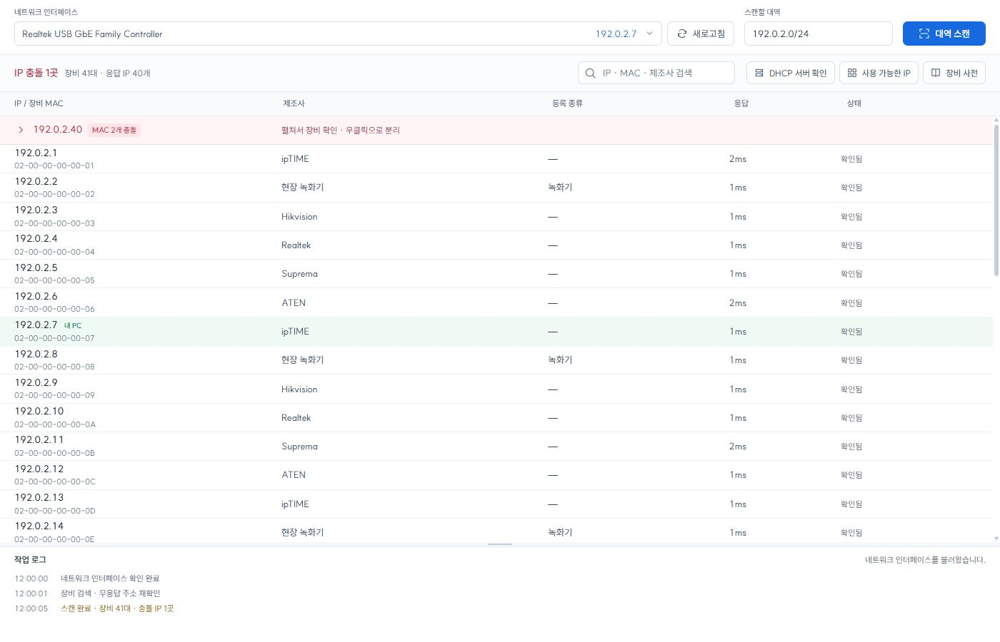

# Quiet Scanner

> **현장에서 IP 충돌을 찾고, 케이블을 뽑지 않고 한 대씩 분리해 처리하는 Windows 도구**

Quiet Scanner는 CCTV·AV·네트워크 설치 현장에서 반복되는 IP 충돌 작업을 단순하게 처리하기 위해 만들었습니다.

현장에서는 같은 IP를 사용하는 장비가 여러 대인데 목록에는 한 대만 보이거나, 충돌 장비를 찾으려고 케이블을 하나씩 뽑아야 하는 일이 있었습니다. Quiet Scanner는 ARP 응답을 반복 수집해 **같은 IP에 응답한 서로 다른 MAC 주소**를 모아 보여 주고, 이 PC에서 선택한 장비에 연결할 수 있게 합니다. 응답하지 않은 장비까지 발견을 보장하지는 않습니다.

4.0부터 화면은 Tauri, 네트워크 처리는 Rust로 구성했습니다. Windows에 설치된 WebView2를 사용하며 별도 Electron·Python 실행 파일을 띄우지 않습니다. AI 개발 도구를 활용해 구현하고, 실제 현장의 충돌 처리 흐름에 맞춰 기능을 줄이고 다듬고 있습니다.

**[Windows 설치 파일 받기](https://github.com/goyohan0611-png/quiet-scanner/releases/download/v4.0.1/Quiet.Scanner.Setup.4.0.1.exe)** · [4.0.1 변경 사항](docs/release-v4.0.1.md)

macOS·Linux 지원은 **4.1 미리보기**에서 추가합니다. Apple Silicon·Intel 맥과 Ubuntu 24.04 이상 x64를 대상으로 하며, 설치·권한·검증 범위는 [다른 운영체제 안내](docs/cross-platform.md)를 참고하십시오. Windows 안정 버전은 4.0.1입니다.



## 핵심 기능

- 선택한 네트워크 인터페이스의 대역을 ARP 방식으로 스캔
- 하나의 IP에 여러 MAC 주소가 응답한 경우 충돌로 표시
- OUI 데이터로 MAC 제조사 표시
- MAC 앞자리(3~6바이트)별 제조사·장비 종류 등록, 수정·삭제
- 전체 MAC 등록으로 특정 장비 한 대에만 적용
- 현재 PC의 IP를 목록에서 구분
- IP를 클릭해 클립보드로 복사
- 장비 우클릭 → **연속 Ping**으로 응답 시간·손실 확인, 중지·재시작
- 장비 우클릭 → **TCP 포트 확인**에서 포트를 입력해 연결 확인
- 충돌 장비를 선택해 이 PC에서만 해당 MAC 주소로 연결되도록 임시 분리
- 작업 로그와 진행률 표시, 로그 영역 크기 조절
- 첫 응답부터 즉시 표시하고, 무응답 주소와 응답 IP의 추가 MAC을 재확인
- 제어판에서 IP를 변경한 뒤 인터페이스 새로고침으로 현재 주소 반영
- **DHCP 서버 확인**: 선택한 인터페이스에서 응답한 서버와 제안 대역을 표시해, 의도하지 않은 DHCP 설정을 확인
- **사용 가능한 IP**: 최근 완료한 스캔의 미응답 주소를 후보로 나열하고 IP 하나 또는 검색한 목록을 복사
- 분리 시 실제 MAC 고정을 확인하고, 해제 확인 실패 시 분리 상태 유지

## DHCP 서버 확인

IP 충돌의 흔한 원인은 누군가 LAN 포트로 꽂아 둔 공유기입니다. 이 공유기가 자기 대역의 주소를 나눠 주기 시작하면 장비마다 다른 주소를 받습니다.

**DHCP 서버 확인** 버튼은 DHCP DISCOVER를 보내고, 응답한 서버마다 IP와 제안한 주소·게이트웨이·DNS·임대 시간을 보여 줍니다. 응답이 없으면 한 번 재시도하며 최대 약 6초간 확인합니다. 여러 응답이 있으면 의도한 구성인지 확인하도록 안내합니다. 서버가 여러 대라는 사실만으로 장애를 확정하지 않습니다.

DHCP REQUEST를 보내지 않으며 이 PC의 주소 설정은 변경하지 않습니다. 서버에는 주소 제안에 따른 임시 기록이 남을 수 있습니다. DHCP 중계가 있는 경우 화면의 MAC과 제조사는 실제 서버 대신 중계 장비의 정보일 수 있습니다. 고정 IP만 쓰는 망에서는 응답이 없는 것이 정상입니다.

## 사용 가능한 IP

대역 스캔을 완료한 뒤 **DHCP 서버 확인** 옆의 **사용 가능한 IP**를 누릅니다. 응답한 장비와 현재 PC의 주소를 제외한 후보를 하나씩 보여 줍니다. IP를 클릭하면 복사하며, 검색 후 **목록 복사**를 누르면 보이는 주소를 줄마다 복사합니다. CIDR 입력에서는 네트워크·브로드캐스트 주소를 제외하고 `/23`·`/22` 안의 유효한 `.0`·`.255` 호스트는 유지합니다.

중지·실패한 새 스캔의 부분 결과로는 후보 목록을 만들지 않습니다. 인터페이스·IP·서브넷 마스크가 변경되면 다시 스캔해야 합니다. 미응답은 미사용을 보장하지 않으므로 할당 전에 DHCP 범위와 예약 IP를 확인하십시오.

## 장비 사전

**장비 사전** 버튼 또는 장비 우클릭 → **MAC 앞자리 등록**에서 관리합니다. 예를 들어 `70-B3-D5-21`을 녹화기로 등록하면 같은 앞자리의 장비에 적용됩니다. 여러 규칙이 일치하면 더 긴 앞자리의 등록이 우선합니다. 전체 MAC 6바이트는 한 장비에만 적용됩니다.

등록·수정·삭제는 현재 목록에도 반영되며, 사용자 사전은 기본 사전과 별도 파일에 저장됩니다.

기본 MAC 제조사 자료는 IEEE의 MA-L·MA-M·MA-S 공개 등록부를 기준으로 갱신합니다. 같은 제조사로 확인되는 새 앞자리는 장비 사전에도 추가하며, 제조사만으로 제품 종류를 단정하지 않도록 새 항목의 장비 종류는 비워 둡니다. 자료의 갱신 시각·출처·검증값은 [데이터 이력](docs/vendor-data.json)에 남깁니다. 사용자가 따로 저장한 사전은 덮어쓰지 않습니다.

## Ping과 TCP 포트 확인

장비를 우클릭해 **연속 Ping**을 선택하면 약 1초 간격으로 확인하고 전송·응답·손실·평균 응답 시간을 표시합니다. 창을 닫거나 중지하면 다음 요청을 보내지 않습니다. Ping 응답이 없다는 사실만으로 장비의 전원 꺼짐을 확정하지는 않습니다.

**TCP 포트 확인**은 `80`, `443`, `8888`처럼 입력한 포트 하나에 TCP 연결을 시도합니다. 연결 성공, 연결 거부, 시간 초과와 경로 오류를 구분합니다. 시간 초과를 포트 닫힘으로 단정하지 않으며, 웹 페이지 내용이나 로그인까지 검사하는 기능은 아닙니다.

두 검사 모두 선택한 인터페이스의 현재 IPv4 주소를 사용합니다. 충돌 IP를 검사하면 다른 MAC의 장비가 응답할 수 있으므로, 특정 장비만 검사하려면 먼저 그 장비를 분리해야 합니다.

## 작업 흐름

1. 네트워크 인터페이스와 스캔 대역을 확인합니다.
2. **대역 스캔**을 실행합니다.
3. 목록 상단의 빨간 충돌 IP를 클릭해 응답한 MAC 주소를 확인합니다.
4. 처리할 장비를 우클릭해 **이 장비만 분리**를 선택합니다.
5. 해당 장비의 웹 설정 화면에서 IP를 변경합니다.
6. 작업이 끝나면 **분리 해제**를 누르고 다시 스캔해 충돌이 사라졌는지 확인합니다.

## 의도적으로 제외한 기능

이 버전은 현장에서 가장 자주 쓰는 흐름에 집중합니다.

- 장비 이름·mDNS·UPnP 정보 수집
- 자동 장비 종류·모델 추정
- 스위치 SNMP, 포트 관리, PoE 제어
- 스캔 기록, 보고서·내보내기

이 기능들은 화면과 스캔 시간을 늘리는 대신 실제 IP 충돌 처리에는 필수가 아니어서 제거했습니다.

## 설치와 실행

[최신 릴리즈](https://github.com/goyohan0611-png/quiet-scanner/releases/latest)의 **Assets**에서 `Quiet.Scanner.Setup.4.0.1.exe`를 내려받아 설치합니다.

설치 프로그램 첫 화면에서 **Npcap / Microsoft Edge WebView2 Runtime** 두 항목의 설치 상태를 확인합니다. 미설치는 빨간색, 설치 완료는 초록색으로 표시합니다. **설치하러 가기**를 누르면 공식 다운로드 페이지가 열립니다. 내려받은 구성 요소를 설치하면 약 1초마다 다시 확인해 상태를 갱신하며, **두 항목이 모두 설치돼야 다음 단계로 진행**합니다. 이미 설치된 항목은 다시 설치하지 않아도 됩니다.

- Windows 10 / 11 64비트
- Windows 4.0.1 안내입니다. macOS·Linux 미리보기의 설치 방식은 [별도 안내](docs/cross-platform.md)를 확인하십시오.
- 관리자 권한 필요. 실행 시 Windows 권한 확인 창이 표시됩니다.
- [Npcap](https://npcap.com) 설치 필요. 기본 설치 위치의 Npcap API를 사용하며 설치 파일에 Npcap을 포함하지 않습니다.
- Microsoft Edge WebView2 Runtime 필요. 없으면 체크리스트의 설치 버튼으로 Microsoft 공식 설치 프로그램을 받아 설치합니다. 새로 받으려면 인터넷 연결이 필요합니다.

설치 파일 하나로 Quiet Scanner를 설치할 수 있습니다. Npcap과 WebView2는 시스템 구성 요소이며, 이미 설치되어 있으면 다시 받을 필요가 없습니다.

## 소스에서 실행·빌드

Node.js LTS, Rust MSVC, Microsoft C++ Build Tools의 **C++를 사용한 데스크톱 개발**과 Windows SDK가 필요합니다.

```powershell
npm ci
npm run dev
```

설치 파일은 `빌드하기.bat` 또는 다음 명령으로 만듭니다.

```powershell
npm run build
```

결과는 `src-tauri/target/release/bundle/nsis/`에 생성됩니다. 새 버전의 사용자 사전과 분리 복구 기록은 `%LOCALAPPDATA%\Quiet Scanner\`에 저장됩니다. 알려진 이전 설치 위치의 기록이 있으면 첫 실행 때 복사하며 원본은 남겨 둡니다. 읽을 수 없는 기록은 덮어쓰지 않고 로그로 알립니다.

## 동작 범위와 주의 사항

- ARP 탐색과 장비 분리는 같은 L2 네트워크, 즉 같은 스위치/브로드캐스트 구간에서 동작합니다.
- 라우터를 넘어가는 다른 대역은 Ping이 되더라도 ARP 충돌을 직접 확인하거나 분리할 수 없습니다.
- 장비 분리는 이 PC의 ARP 연결만 임시로 고정합니다. 장비 설정을 직접 바꾸는 기능은 아닙니다.
- 작업 후에는 반드시 분리를 해제하거나 다시 스캔하십시오. 다음 실행 시 남은 분리는 자동 정리합니다.
- 분리 성공은 이 PC의 IP→MAC 고정 확인을 뜻하며, 장비의 웹 서비스나 전원이 정상이라는 뜻은 아닙니다.
- DHCP 서버 확인은 선택한 네트워크에서 도달하는 응답을 확인합니다. DHCP 중계 구성에서는 서버가 다른 네트워크에 있을 수 있습니다. 스캔 중에는 실행할 수 없습니다.
- 해제 확인에 실패하면 기존 분리 표시와 복구 기록을 유지합니다. 해제 전에는 다른 장비 분리나 재스캔을 시작하지 않습니다.

## 검증

실제 장비에 쓰기 작업을 하지 않는 실패 경로 테스트를 제공합니다.

```powershell
cargo test --manifest-path src-tauri/Cargo.toml
node scripts/test_tauri_bridge.cjs
python -m unittest discover -s scripts -p test_vendor_data.py
node scripts/test_installer.cjs
```

Rust 테스트는 주소 범위 계산, ARP·DHCP 패킷 해석, 잘못된 DHCP 응답 거부, MAC 고정 확인과 해제 실패 처리, 발견 장비 병합, 동시 실행 차단, 사전 저장 실패와 재로딩을 다룹니다. 화면 연결 테스트는 이벤트 수신 준비, 오류 전달, 클립보드 요청을 확인합니다. 실제 충돌 장비와 분리·해제 동작은 별도의 현장 검증이 필요합니다.

설치 검사 테스트는 NSIS 도구가 필요합니다. Tauri 빌드가 내려받은 기본 경로를 사용하며, 다른 위치라면 `MAKENSIS` 환경 변수로 지정합니다. 테스트용 상태와 실제 PC의 감지 결과를 확인하며 드라이버·런타임을 설치하거나 삭제하지 않습니다.

## 기술 구성

- Tauri 2 + Rust
- HTML / CSS / JavaScript, SUIT Variable 글꼴을 로컬에 포함한 고밀도 화면
- Windows IP Helper API: 인터페이스 새로고침, ARP 고정·해제와 결과 확인
- Npcap: Ethernet 프레임 송수신, ARP 탐색과 DHCP DISCOVER
- NSIS: Windows 설치 파일

`src-tauri/`가 현재 네트워크 엔진과 데스크톱 앱입니다. `electron/renderer/`는 현재도 사용하는 공용 화면입니다. 이전 Electron 호스트, Python 코드와 기존 빌드 스크립트는 이관 비교용으로 남겨 두었으며 4.0 설치 파일에는 포함하지 않습니다.

기본 제조사 자료를 갱신하려면 `python tools/build_oui.py`를 실행합니다. 개발용 갱신 명령이며, 설치된 앱은 인터넷에서 사전을 자동으로 내려받지 않습니다.

## 라이선스

GPLv2. 자세한 내용은 [LICENSE.md](LICENSE.md)를 참고하십시오.

